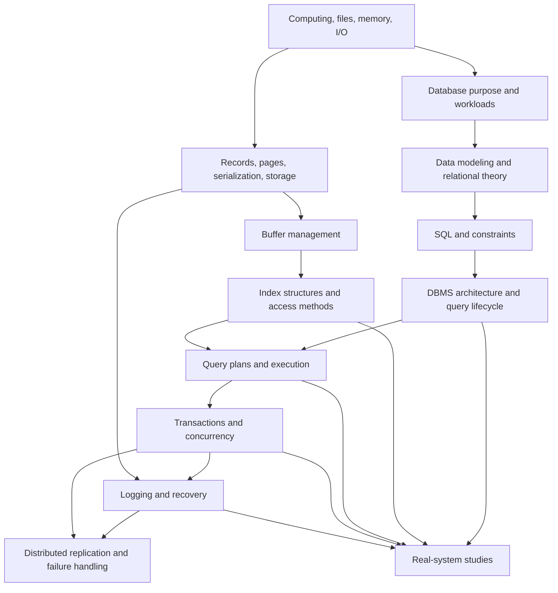

# LearnDatabase Roadmap

**Status:** Curriculum scope baseline — maintained; structural architecture work is tracked in `PROGRESS.md`
**Purpose:** Sequence a university-level, multi-volume database textbook collection, its research, and its parallel engineering track.

## Proposed repository architecture

```text
LearnDatabase/
├── README.md
├── ROADMAP.md
├── PROGRESS.md
├── RESEARCH.md
├── RESEARCH_INDEX.md
├── RESEARCH_MAP.md
├── CURRICULUM_DEPENDENCY_MATRIX.md
├── EDUCATIONAL_STANDARDS.md
├── IMPLEMENTATION_SPECIFICATIONS.md
├── SUMMARY.md
├── CONTRIBUTING.md
├── docs/
│   ├── volume-01-foundations/
│   │   ├── README.md
│   │   ├── part-01-data-and-computing/
│   │   └── part-02-database-systems/
│   ├── volume-02-data-modeling-relational-theory/
│   ├── volume-03-sql-and-database-use/
│   ├── volume-04-database-architecture/
│   ├── volume-05-storage-engines/
│   ├── volume-06-indexes-and-access-methods/
│   ├── volume-07-query-processing-and-optimization/
│   ├── volume-08-transactions-and-concurrency/
│   ├── volume-09-logging-recovery-and-durability/
│   ├── volume-10-distributed-database-systems/
│   ├── volume-11-advanced-database-engineering/
│   ├── volume-12-real-world-system-internals/
│   └── volume-13-build-a-database-from-scratch/
├── implementations/
│   ├── rust/                 # Introduce a Cargo workspace when first crate is approved
│   ├── cpp/                  # Selective comparisons
│   └── examples/             # Small, language-neutral or SQL examples
├── labs/
├── exercises/
├── research/
│   ├── papers/
│   ├── books/
│   ├── courses/
│   ├── documentation/
│   ├── source-code-studies/
│   └── engineering-articles/
├── references/
├── diagrams/
└── glossary.md
```

The book layout gives each volume and part a navigation page, keeps chapter numbers stable, and separates explanatory text from runnable learning projects. Each chapter uses relative cross-references to prerequisites and follow-on concepts. A Rust workspace is deferred until a first Rust crate exists. No empty chapter directories or documents are created as placeholders. The source report suggested a `src/` layout but did not define crate boundaries; implementations are therefore grouped under `implementations/` to distinguish this learning repository from a single software product.

## Curriculum blueprint

Each domain is taught through a theory track and a linked practice track. The sequence below combines the prompt's levels with foundational operating-system and data-structure prerequisites that the supplied report identifies but does not develop.

| Stage | Theory path | Practice path |
|---|---|---|
| 0. Computing and data foundations | Bits/bytes, processes, memory, files, I/O, latency, data structures, client/server basics | Inspect files and data encodings; small parsing and measurement exercises |
| 1. Database fundamentals | Data vs information, database vs DBMS, workloads, relational/document/key-value/analytical models, system responsibilities | Use an existing DBMS; compare file-based and managed storage behavior |
| 2. Modeling and relational theory | Relations, tuples, domains, constraints, keys, ER modeling, functional dependencies, normalization, relational algebra/calculus | Model a small domain; derive relational algebra operations and validate schemas |
| 3. SQL | DDL/DML/querying, joins, aggregation, subqueries/CTEs, windows, constraints, views, transactions, plans | Query a sample dataset; explain and compare plan shapes |
| 4. DBMS architecture | Client interface, parser, catalog, planner, executor, storage/buffer/transaction managers; query lifecycle | Trace a query through a system using verified documentation or source |
| 5. Storage foundations | Encoding, records, pages, slotted pages, heap files, disk I/O, buffer pool and replacement | Serialization exercises, page layout simulator, then buffer-pool model |
| 6. Indexes and access methods | Hashing, B/B+ trees, LSM trees, Bloom filters, skip lists, index maintenance | In-memory index experiments followed by persistent structures when prerequisites permit |
| 7. Query execution and optimization | Logical/physical plans, operators, iterator and vectorized models, joins, pushdown, costs and cardinality | Implement scan/filter/join operators; inspect and compare plans |
| 8. Transactions and concurrency | ACID, schedules, conflict serializability, locks/2PL, deadlocks, timestamps, OCC, MVCC and isolation | Schedule analysis and small lock/version visibility models |
| 9. Logging and recovery | WAL ordering, undo/redo, checkpoints, crash cases, recovery algorithms, durability limits | Log-format and recovery simulations with enumerated crash points |
| 10. Distributed databases | Failure models, replication, partitioning, quorum, consensus/Raft, 2PC, consistency, CAP/PACELC, distributed SQL | Deterministic simulations before any networked replication experiment |
| 11. Advanced and comparative topics | Columnar storage, compression, vectorization/JIT, time-series, graph/search, security, observability, cloud-native systems | Focused comparative labs tied to a specific question and source |

SQL is its own learning stage, but query plans and transaction semantics recur later when learners can connect syntax to engine behavior. C++ is used only when a targeted comparison illuminates lifetime, RAII, templates, or low-level implementation choices.

## Multi-volume textbook hierarchy

The hierarchy below is the working table of contents. Chapter groupings may be split when a subject needs its own derivation or algorithm treatment. Numbering is stable within each volume; a chapter is added only when it has real content. This is an estimate of scope, not a publication quota.

### Volume I — Data, Computing, and Database Foundations (11 chapters)

Part I: Data and computation — V01-C01 What Is Data?; V01-C02 Meaning, Models, and Information; V01-C03 Information Theory: Uncertainty, Entropy, and Coding; V01-C04 Bits, Bytes, Types, and Encodings; V01-C05 Files, Memory, and Persistent Storage; V01-C06 Programs, Processes, and Client–Server Basics.

Part II: Database systems — V01-C07 What Is a Database?; V01-C08 What Is a DBMS and Why Use One?; V01-C09 Files and Application-Managed Data vs DBMS; V01-C10 Database Workloads and System Families; V01-C11 A First Map of a Database System.

### Volume II — Data Modeling and Relational Theory (10–14 chapters)

Modeling requirements and entities; ER diagrams and constraints; relational model, relations/tuples/domains; keys and integrity; functional dependencies; inference and candidate keys; normalization (1NF, 2NF, 3NF, BCNF); decomposition and lossless join/dependency preservation; relational algebra; relational calculus; logical data independence; schema design case studies.

### Volume III — SQL and Database Use (12–16 chapters)

SQL history and standards; schemas/types/DDL; constraints and keys; SELECT and expressions; filtering, NULL and three-valued logic; joins; aggregation; subqueries and CTEs; set operations; window functions; views; DML and data change; transaction statements; SQL security and privileges; reading execution plans; a scoped SQL dialect comparison.

### Volume IV — Database Architecture (8–12 chapters)

System boundaries and interfaces; client/server and embedded models; connection/process/thread models; query lifecycle; lexical analysis/parsing/AST; catalog and metadata; logical and physical plans; executor and operator interfaces; storage/buffer/transaction managers; monitoring and utilities. Architecture concepts are cross-checked against multiple systems.

### Volume V — Storage Engines (10–14 chapters)

Storage hierarchy and latency; records and tuple formats; binary encoding and portability; pages and blocks; slotted-page layout; heap files and free-space management; buffer pool and pin/latch concepts; replacement policies; I/O paths and write buffering; checksums and page integrity; large values; row vs column layouts; LSM storage overview; storage testing and crash boundaries.

### Volume VI — Indexes and Access Methods (10–14 chapters)

Index purpose and cost model; ordered indexes; B-tree and B+ tree page anatomy; search and range scans; insertion, splitting and propagation; deletion, redistribution and merging; concurrency and latching; recovery and structural changes; hash indexes; extendible/linear hashing; LSM trees, memtables, SSTables and compaction; Bloom filters and skip lists; bitmap, inverted and spatial indexes; index selection and maintenance.

### Volume VII — Query Processing and Optimization (10–14 chapters)

Relational algebra review; parsing and binding; logical plans and equivalence; physical operators; iterator/Volcano execution; vectorized and push-based execution; scans and filters; sorting and aggregation; nested-loop, hash and sort-merge joins; cardinality and selectivity estimation; cost models; rule-based and cost-based optimization; predicate/projection pushdown; parallel execution and JIT; plan inspection and benchmarking.

### Volume VIII — Transactions and Concurrency (10–14 chapters)

Transaction model and ACID; histories and schedules; conflict/view serializability; lock modes and compatibility; 2PL and strictness; deadlocks; timestamp ordering; optimistic concurrency; MVCC versions and visibility; snapshot isolation; SQL isolation anomalies and standards; vendor isolation mappings; latches vs locks; concurrency testing.

### Volume IX — Logging, Recovery, and Durability (8–12 chapters)

Failure models; volatile and stable storage assumptions; WAL rule; log record formats; undo/redo; checkpoints; ARIES analysis/redo/undo; torn pages and doublewrite approaches; group commit and flush semantics; recovery algorithms in systems; crash testing; durability claims and hardware caveats.

### Volume X — Distributed Database Systems (10–14 chapters)

Network and failure models; partitioning/sharding; replication topologies; consistency models; quorums; consensus foundations; Raft; distributed transactions and 2PC; clocks and ordering; distributed query processing; CAP assumptions and limits; PACELC; distributed SQL; rebalancing and operational failures.

### Volume XI — Advanced Database Engineering (10–16 chapters)

Columnar systems; compression and encoding; vectorization and compilation; in-memory systems; time-series, graph, search and event data; cloud-native storage/compute separation; security and threat modeling; observability; benchmarking and workload design; performance diagnosis; admission control and resource governance; emerging research selected through ongoing reviews.

### Volume XII — Real-World Database System Internals (8–12 system studies)

Separate, source-backed studies of PostgreSQL, SQLite, MySQL/InnoDB, DuckDB, RocksDB, LevelDB, Redis, and FoundationDB, plus later systems only when they contribute a distinct architectural lesson. Each study is broken into chapters where architecture, storage, access methods, query/execution, transactions, recovery, operations, and trade-offs warrant separate treatment. Exact source paths and version claims are included only after verification.

### Volume XIII — Building a Database from Scratch (22 milestone specifications plus synthesis)

One learning unit per implementation milestone in the engineering roadmap below, mapped to the existing 22 milestone specifications. A unit may later split into multiple chapters where needed; do not invent chapter IDs until that decomposition is approved. Each specification identifies prerequisites, theory references, architecture, data layout, algorithms, coding tasks, correctness properties, tests, expected behavior, limitations, and completion gate. This volume serves as an implementation companion across the theory volumes rather than a shortcut that replaces them.

**Initial scope estimate:** approximately 130–175 substantive chapters across thirteen volumes, plus volume introductions, part guides, glossary/index, labs, and solutions. The range follows the number of distinct algorithms, data models, failure semantics, and system studies required by the prompt: for example, B+ tree insertion/deletion/concurrency/recovery each need independent worked treatment, while basic terms can share a foundations chapter. The estimate is deliberately broad and will be recalibrated after full research mapping and early chapter reviews. It is not a target for file count or a cap; splitting or merging chapters must follow learning value.

### Chapter numbering and cross-reference conventions

Use volume-prefixed identifiers (`V01-C01`) as stable references even if filenames change. Use descriptive filenames with the ID, e.g. `V01-C01-what-is-data.md`. Volume and part landing pages list chapter titles, prerequisites, status, and next steps. Chapters link to prerequisite concepts, glossary entries, related engineering milestones, and references. The glossary uses one canonical entry per term; alternate names point to it. The concept index maps terms, algorithms, systems, and symbols to chapter anchors. Mathematical notation is introduced in a notation note and defined locally when first used; use GitHub-compatible display math delimited with `$$`. Mermaid diagrams and pseudocode remain text-based and have accompanying prose explanations.

### Measurable complete-chapter standard

The authoritative status definitions and evidence checklist are in [EDUCATIONAL_STANDARDS.md](EDUCATIONAL_STANDARDS.md). The following summary is retained as the roadmap-level gate; status must be backed by recorded evidence rather than file presence or a prior label.

A chapter may be marked COMPLETED only when all applicable checks below are met and recorded in its status entry:

1. **Navigation:** stable ID, title, volume/part placement, objectives, prerequisites, previous/next links, glossary/index links, and references are present.
2. **Learning arc:** introduces motivation and context; defines terms; develops concepts in dependency order; explains mechanisms, assumptions, boundaries, and trade-offs; ends with a synthesis tied back to objectives.
3. **Technical depth:** every central claim is supported or marked as an explicit inference/open question. Algorithms state inputs, outputs, invariants, edge cases, and asymptotic or I/O costs where relevant. Worked mechanisms include enough intermediate steps to reproduce the result.
4. **Representations and flows:** where relevant, memory/disk structures and execution/recovery flows are shown with labeled diagrams, tables, or traces and explained in prose.
5. **Theory/engineering link:** a practical experiment or implementation plan connects to the chapter. Code is included only when it adds learning value; it has scope, correctness conditions, and explained design choices.
6. **Systems evidence:** system-specific claims identify product and version/date and link to official documentation, paper, or verified source location. Shared concepts and product decisions are clearly distinguished.
7. **Practice:** exercises progress from comprehension to analysis/design/application; solutions or grading criteria exist in the approved solution policy. A complex algorithm has a hand-worked example or equivalent experiment.
8. **Editorial review:** terminology, notation, internal links, references, examples, and chapter structure are checked; simplifications and known omissions are disclosed.
9. **Status discipline:** all acceptance checks are complete; unresolved material issues keep the chapter IN PROGRESS or NEEDS REVIEW. Passing tests alone does not establish algorithm or database correctness.

There is no minimum or maximum word count. Depth is measured by coverage of the subject's necessary learning outcomes, reproducible reasoning, evidence, and review criteria—not length.

## Technical dependency map



This is a conceptual dependency map, not a claim that every production engine follows the same architecture. System studies will mark common concepts separately from implementation-specific choices.

## Build-your-own database implementation roadmap

Milestones are deliberately gated by the theory that makes their correctness questions understandable. Detailed per-milestone specifications are in [IMPLEMENTATION_SPECIFICATIONS.md](IMPLEMENTATION_SPECIFICATIONS.md); the list is a plan and none is started. Cross-volume topic dependencies are recorded in [CURRICULUM_DEPENDENCY_MATRIX.md](CURRICULUM_DEPENDENCY_MATRIX.md).

| # | Milestone | Prerequisite concepts / expected result |
|---:|---|---|
| 1 | In-memory key-value store | Rust basics, collections, error handling; get/put/delete with explicit semantics |
| 2 | Persistent key-value store | File I/O, encoding, failure boundaries; reopen and recover stored values |
| 3 | Record storage | Types, serialization, record identifiers; encode/decode records with validation |
| 4 | Page-based storage | Blocks, offsets and page I/O; a page file with defined allocation/read/write behavior |
| 5 | Page layout and serialization | Page headers, slot directories, encoding and invariants; validate records within pages |
| 6 | Buffer pool | Page I/O, pin/latch distinction, replacement; bounded frames with observable eviction behavior |
| 7 | Hash index | Hashing, collisions, persistence trade-offs; lookup/update with defined collision handling |
| 8 | B+ tree | Ordered search, pages, split/merge invariants; range and point lookup across persisted nodes |
| 9 | Tables and schemas | Catalogs, types, constraints, record/index integration; create and scan a simple table |
| 10 | SQL lexer | Character classes and token boundaries; tokenize a defined SQL subset |
| 11 | SQL parser | Grammar, precedence and errors; parse supported statements deterministically |
| 12 | Abstract syntax tree | Typed syntax representation and traversal; inspect and transform supported statements |
| 13 | Query executor | Relational operators, tuples, iterators; scan/filter/project and selected joins |
| 14 | Basic query planner | Logical/physical plans and simple cost inputs; select among a small set of valid plans |
| 15 | Transaction management | Atomicity/consistency and schedules; transaction state and single-process semantics |
| 16 | Write-ahead logging | Persistence ordering and log records; enforce log-before-data in the declared model |
| 17 | Crash recovery | Undo/redo/checkpoint theory; deterministic recovery scenarios and documented limits |
| 18 | Concurrency control | Locks, deadlocks, isolation anomalies; controlled concurrent transaction schedules |
| 19 | MVCC | Version chains, snapshots, visibility and cleanup; snapshot reads with defined isolation scope |
| 20 | Query optimization | Equivalence rules, estimates and plan costs; explainable, scoped rewrites |
| 21 | Client/server protocol | Framing, errors, resource limits and concurrency; local client and server with protocol tests |
| 22 | Replication | Failure models, ordering, consensus prerequisites; simulation first, then a scoped protocol experiment |

Milestone order aligns with the owner's 22-step specification while splitting page storage from page layout/serialization and separating lexer, parser, and AST. It also separates persistent KV and record storage, adds table/schema integration before SQL execution, and places transaction recovery and concurrency in dependency-aware order. Exact page size, replacement policy, concurrency model, SQL subset, dependencies, and durability claims must be chosen and justified before their milestone begins.

## Real-system study sequence

Study PostgreSQL, SQLite, MySQL/InnoDB, DuckDB, RocksDB, LevelDB, Redis, and FoundationDB as distinct systems. Each study will use current official documentation and verified source locations where needed, and cover purpose, architecture, storage, indexing, query processing, transactions, concurrency, recovery, performance context, trade-offs, and evidence. Select one system only after its relevant concepts have been introduced; do not infer one engine's behavior from another.

## Initial task breakdown (superseded by TODO.md)

| Order | Task | Acceptance criteria | Status |
|---:|---|---|---|
| 1 | Review this proposed foundation | Owner confirms or requests changes to architecture, sequence, scope, and initial content target | NEEDS REVIEW |
| 2 | Create the approved minimal repository structure and contribution conventions | Only approved directories/files; navigation and status conventions documented | NOT STARTED |
| 3 | Curate and verify the core reading path | Entries have direct URLs, verified metadata/status/date, tier, topic, difficulty, prerequisites, and chapter mapping | NOT STARTED |
| 4 | Publish the glossary and Chapter 0 | Terms defined consistently; chapter follows agreed template and cites verified sources | NOT STARTED |
| 5 | Develop Level 1 fundamentals | Theory/practice objectives, prerequisites, examples and review checks included | NOT STARTED |
| 6 | Start the first implementation only when its theory prerequisites are ready | Milestone spec defines correctness, scope, validation and expected result before code | NOT STARTED |

This original assessment queue is retained as historical context. Current tasks are in [TODO.md](TODO.md); stable chapter IDs and statuses are in [CHAPTER_STATUS.md](CHAPTER_STATUS.md). Follow the active user instruction for phase boundaries; do not infer authorization to begin a later major phase from this roadmap.

## Validation and change control

For each future content change: review chapter structure, prerequisite ordering, terminology, internal links, evidence and version context. For Rust work, apply the specified formatting, check, test, and lint workflow when code exists. Record exactly what was checked and what remains outside the check. Do not mark work complete based only on document length, passing tests, or a source summary.

For references, record title, author/organization, year, type, topic/subtopic, difficulty, prerequisites, authority tier, importance class, chapter mapping, direct URL, verification status, and last verified date. Maintain a Core Reading Path and a separately browsable Extended Research Catalog; avoid an unranked link dump.

## Documentation standards

Educational chapters use the following structure when each section materially helps the topic:

1. Title and learning objectives.
2. Prerequisites.
3. Introduction and problem statement.
4. Core concepts and detailed explanation.
5. Internal mechanisms, algorithms, data structures, and invariants.
6. Diagrams and worked examples.
7. Practical implementation, with the language and scope identified.
8. Exercises and common mistakes.
9. Performance, security, and correctness considerations.
10. Real-system examples, explicitly marked as implementation-specific.
11. Summary and further reading.
12. References tied to the claims they support.

Write in original wording. Define terms before relying on them, explain why as well as what, label simplifications and version-specific behavior, avoid unnecessary repetition, and do not fabricate citations or exact source locations. Rust examples explain the design purpose and relevant ownership/concurrency choices; they do not imply that Rust guarantees database-level correctness. Include C++ only when a comparison materially clarifies the topic.

Before a chapter is marked COMPLETED, review prerequisite order, structure, terminology, examples, internal links, and claim-to-source support. Record unresolved claims as uncertain or open questions. A test passing supports only the properties it exercises; state relevant untested cases and assumptions.
