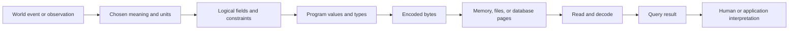

# V01-C01 — What Is Data? From Observations to Stored Representations

**Volume:** I — Data, Computing, and Database Foundations
**Part:** I — Data and Computing
**Status:** NEEDS REVIEW
**Prerequisites:** None
**Next:** [V01-C02 — Meaning, Models, and Information](V01-C02-meaning-models-information.md)
**Glossary:** [Canonical terms](../../../glossary.md)
**Concept index:** [Index](../../../INDEX.md)

## Learning objectives

After studying this chapter, you should be able to:

1. Explain what this book means by *data*, *information*, *representation*, and *interpretation*.
2. Trace a real-world observation through a stored representation and back to a human-readable result.
3. Distinguish a value from its encoding, a field from its meaning, and a database from a DBMS.
4. Explain why storing data requires explicit choices about types, units, identity, missingness, and time.
5. Identify ways that a representation can lose information or cause an incorrect interpretation.
6. Describe why persistent data management becomes difficult when information is large, shared, evolving, or safety-critical.

Objective-to-assessment mapping appears in [Section 12](#12-exercises-and-assessment); model answers and grading criteria are in the separate [solution guide](solutions/V01-C01-solutions.md).

| Objective | Primary evidence |
|---|---|
| 1. Explain data, information, representation, interpretation | Exercises 1 and 3 |
| 2. Trace observation through representation to result | Exercises 1 and 2 |
| 3. Distinguish value/encoding, field/meaning, database/DBMS | Exercises 1 and 4 |
| 4. Explain type, units, identity, missingness, and time choices | Exercises 2 and 3 |
| 5. Identify information loss and misinterpretation | Exercises 2 and 3 |
| 6. Explain persistent data-management difficulty | Exercise 4 and the practical experiment |

## 1. A starting point: a value is not yet a useful record

Suppose a weather station reports the number `18.4`. By itself, that number is not enough to answer even a basic question. It might mean 18.4 degrees Celsius, 18.4 degrees Fahrenheit, 18.4 millimeters of rain, a wind speed, or a sensor voltage. It also lacks a place, a time, a sensor identity, and any statement about whether the measurement passed quality checks.

Now place it in a record:

| station_id | observed_at | temperature_c | quality |
|---|---|---:|---|
| ST-07 | 2026-11-11T09:00:00+07:00 | 18.4 | accepted |

This record is more interpretable because its fields provide names and context. But several questions remain: Is `ST-07` globally unique or only unique within one organization? Does the timestamp describe the station's local clock or a normalized instant? Does `accepted` mean the sensor passed calibration, or merely that the software parsed the reading? Can `temperature_c` be absent? If present, how many decimal places are meaningful?

This simple example introduces the central lesson of the book: stored symbols do not carry their full meaning by themselves. A system stores representations under conventions. People and programs interpret them using schemas, documentation, constraints, and shared assumptions. Database engineering is partly the work of making these conventions explicit and maintaining them as data is stored, queried, changed, shared, and recovered after failures.

## 2. Data, information, representation, and interpretation

The word *data* is used in several ways in everyday speech and in technical writing. This book uses the following working distinctions.

- **Observation:** something recorded about a person, object, event, or process. Examples include a payment, a temperature reading, or a book title.
- **Value:** one recorded item, such as `18.4`, `"ST-07"`, or a timestamp.
- **Data:** values or symbols represented so they can be stored, transmitted, transformed, or processed.
- **Representation:** the chosen form for data: a text string, integer, binary floating-point number, table row, JSON document, or bytes in a file.
- **Interpretation:** the rules that connect a representation to a meaning. For instance, the bytes `31 38 2E 34` may be interpreted as the UTF-8 text `18.4`; a schema may then say that this text is a decimal temperature in Celsius.
- **Information:** data interpreted in a context that makes it useful for some question or decision.

These are useful teaching distinctions, not universal formal definitions. Different disciplines define *data* and *information* differently. In database engineering, the practical concern is to record enough structure and rules that software can interpret values consistently, including after the original programmer or operator is gone.

### 2.1 Data does not explain itself

Consider a CSV row:

```text
ST-07,2026-11-11T09:00:00+07:00,18.4,accepted
```

The row is a sequence of characters. To use it, a program needs conventions:

1. Commas separate fields, unless quoted according to the file's rules.
2. The first field is a station identifier.
3. The second field is a timestamp with a numeric UTC offset.
4. The third field is a temperature in degrees Celsius.
5. The fourth field belongs to a controlled set of quality labels.

If one application assumes the temperature is Celsius and another assumes Fahrenheit, both may parse the same characters successfully and still disagree about the world. Parsing answers “can I recognize a representation?” It does not answer “is this the right representation or meaning?”

### 2.2 Schema: a shared description of structure

A **schema** is a declared description of some data's structure and rules. A schema might specify that a station observation has an identifier, an instant, a decimal temperature, and a quality state. Schemas can include types, constraints, relationships, and naming conventions.

Schemas are not merely paperwork. They help software reject invalid values, choose operations, and communicate expectations between independently written components. A schema is also not a complete description of reality: it records selected aspects of the world for a purpose. If an observation's real precision is only about one degree, storing six decimal places does not create six decimal places of measurement accuracy.

It is useful to distinguish a **schema** from a **database state**. The schema describes the allowed shape and rules; a state is the particular set of values held at one time. A schema can say that `temperature_c` is a decimal measurement and that `station_id` identifies a station. It cannot, by itself, establish that the sensor was calibrated or that a producer used Celsius. A constraint can reject values outside a declared range, but a value inside the range can still be wrong. Syntactic validity, declared-rule validity, and truth about the world are different questions.

## 3. From the world to bits and back

A database ultimately relies on physical devices and software representations. The path from an event in the world to a query result has several conceptual stages:



Every transformation is a possible place for error. A Fahrenheit value may be placed in a Celsius field; a local wall-clock time may be treated as a universal instant; a decimal may be rounded to binary floating point; a string may be truncated; a byte sequence may be decoded using the wrong character encoding; a query may silently exclude missing values.

We can describe the path without assuming that each stage is reversible. Let `O` be a set of possible real-world states, `X` a set of observations, `V` a set of application values, and `B*` the set of finite byte strings. A sensor or reporting process maps some world states to observations, `s: O ⇀ X`; an encoder maps supported values to bytes, `e: V → B*`; a decoder maps recognized byte strings back to values, `d: B* ⇀ V`; and an interpretation rule maps a decoded value plus schema and context to a claim, `i: V × Schema × Context ⇀ Claim`. The hooked arrow indicates a partial function: some inputs may be unsupported, missing, malformed, or ambiguous. A lossless encoding aims for `d(e(v)) = v` for every supported value `v`. That round trip says nothing by itself about whether the observation was accurate or whether the schema and context were correct. Sampling, rounding, unit conversion, filtering, and missing-value policies can discard distinctions before bytes are stored.

For example, if temperature is rounded to the nearest tenth before storage, distinct sensor readings may map to the same stored value. No decoder can recover which original reading occurred from the rounded value alone. This is information loss in the chosen transformation, not necessarily a storage defect: rounding may be appropriate if it matches measurement precision and application requirements. The engineering requirement is to state where loss occurs and why it is acceptable.

Later volumes study specific representations in detail. For now, keep these layers separate:

1. **Meaning:** What real-world fact or event is intended?
2. **Logical structure:** What fields, entities, and relationships describe it?
3. **Program representation:** What types and values do software components manipulate?
4. **Physical representation:** What bytes are placed in memory, files, pages, logs, or network messages?
5. **Presentation:** How a query result is shown to a person or consumed by another program?

One logical value may have multiple physical representations. A database may store a date as an integer count, a text string, or several binary fields. Conversely, identical bytes can mean different things under different schemas. A crucial database goal is to let users reason at an appropriate logical level without having to manually manage every physical detail.

## 4. Why persistent data management is hard

A small program can write values to a text file. As needs grow, however, the application must solve an expanding set of problems.

### 4.1 Finding and organizing data

If a file contains a million observations, scanning every line for station `ST-07` may be too slow. The application can build a lookup structure, but then it must keep that structure consistent when records are inserted, changed, or deleted. If several questions require different orderings, the application may need several structures and an update procedure for each.

### 4.2 Sharing data among programs and people

Suppose a monitoring application, a reporting tool, and an alert service all use the same observations. If each program has its own copy, updates can diverge. If they share a file, simultaneous writes can overwrite one another or expose partially written records unless a coordination protocol is designed and obeyed by every client.

### 4.3 Keeping data valid

An observation may refer to a station that does not exist, use an unsupported quality label, or duplicate an event identifier. An application can check these cases, but every writer must apply compatible checks. A second script, an import job, or a future service can bypass an assumption that only lived in the first application's code.

### 4.4 Changing software while preserving data

Requirements evolve. A station may gain altitude and manufacturer fields; a timestamp policy may change; an identifier may need a larger range. If data layout and application code are tightly coupled, every change can require coordinated rewrites. Data often outlives the program that first created it.

### 4.5 Surviving failures

Programs can stop during an update. Operating systems can crash; machines can lose power; storage devices can return errors. If an update changes several related values, a failure halfway through may leave an inconsistent state. A system must define what counts as committed and how incomplete changes are handled.

### 4.6 Coordinating concurrent operations

Two users may update the same account or inventory item at the same time. A report may read while an update is underway. The system must decide what each operation can observe, which operations can proceed together, and how conflicts are resolved. These rules are called concurrency control and transaction semantics; they are developed much later in Volumes VIII and IX.

These needs are not proof that every task requires a large database server. A small configuration file can be the right tool for a tiny, single-writer workload. The point is that persistence, sharing, correctness, and recovery create engineering responsibilities. Database systems package many such responsibilities behind a data model and interface.

## 5. Database, database contents, and DBMS

Technical writing sometimes uses *database* to mean the stored collection, and sometimes uses it to mean the software system. This ambiguity causes confusion, so this book uses these terms carefully:

- A **database** is an organized collection of data maintained for some purpose. It may also refer, in a product's terminology, to a named logical container inside a larger system.
- A **database management system (DBMS)** is software that defines, stores, retrieves, updates, and manages databases, while providing interfaces and rules for users or programs.
- A **database system** is the combination of a DBMS, the databases it manages, client programs, and the operating environment needed to use them.

Different products use these words differently. For example, PostgreSQL 18 documentation defines a database cluster as a collection of databases stored in a common data area and states that a running server instance handles client connections through server processes [R-005]. SQLite's official guidance describes a different design center: local application storage through an embedded engine and database file, with client/server systems favored for different sharing and centralization needs [R-006]. These examples are product- and version-specific; neither defines the universal meaning of DBMS, and SQLite's guidance is not a general workload-selection theorem.

The logical distinction remains useful: the **data** is not the same thing as the **software that manages it**. Losing the distinction is like confusing a document with the word processor that edits it, though databases add concurrency, recovery, query, and integrity machinery that makes the analogy incomplete.

## 6. What a DBMS contributes

A DBMS typically brings together several capabilities. Database architecture surveys describe different process, storage, transaction, and query-processing designs rather than one universal module layout [R-002]. The following is a teaching map of recurring responsibilities, not a claim that every system implements each one:

| Responsibility | Question the system helps answer |
|---|---|
| Data definition | What structures, types, and constraints are declared? |
| Data manipulation and queries | How can users request, insert, update, or remove selected data? |
| Storage and access methods | How are records organized, found, and moved between memory and persistent storage? |
| Integrity enforcement | Which values and relationships are allowed? |
| Transaction processing | Which groups of operations succeed or fail as a unit? |
| Concurrency control | What happens when operations overlap? |
| Logging and recovery | What survives a crash, and how is a consistent state restored? |
| Security and authorization | Which users may see or change which data? |
| Catalog and metadata | What structures exist, and what does the system know about them? |
| Administration and observability | How can operators inspect, back up, tune, and diagnose the system? |

This table is a conceptual map, not a claim that every DBMS implements each responsibility in the same module or offers the same guarantees. A DBMS can centralize checks that otherwise would be scattered across applications. That centralization has costs too: the DBMS must be configured, monitored, secured, and operated; clients must understand its semantics; and a poorly chosen or poorly used DBMS can add needless complexity.

## 7. A brief historical perspective

Database systems grew from the need to manage persistent, structured data, especially when data volumes and the number of users exceeded what ad hoc files and individual programs could comfortably support. Early systems commonly exposed navigational structures: an application followed predefined links or access paths through records. Such approaches can be efficient, but application logic may depend on how records are physically arranged or connected.

In 1970, Edgar F. Codd published “A Relational Model of Data for Large Shared Data Banks.” Its abstract argues that users and most application programs should not have to know the machine's internal data organization, and introduces a model based on n-ary relations, a relational normal form, and a data sublanguage; it also discusses relational operations in connection with redundancy and consistency [R-001]. This describes the paper's proposal, not a claim that every later relational DBMS implements every idea as Codd formulated it. Relational ideas required further theory, prototypes, commercial products, language development, and engineering before broad adoption.

The lasting lesson for this introductory chapter is not that one model solved every data problem. It is that a data model can create a boundary between how users describe data and how an engine physically stores it. Later books will compare relational, document, key-value, graph, columnar, and other models, and will show where abstractions help or impose constraints.

## 8. A worked trace: recording a payment

Consider a purchase of 12.50 units of currency by customer `C-104` at 10:15. A careless design might store a single string:

```text
C-104 paid 12.50 at 10:15
```

This is readable, but software must guess where fields begin, what currency applies, whether `10:15` includes a date or time zone, and whether the payment succeeded. A more structured logical record could be:

| payment_id | customer_id | amount_minor_units | currency | occurred_at | state |
|---|---|---:|---|---|---|
| P-9931 | C-104 | 1250 | THB | 2026-11-11T10:15:00+07:00 | captured |

Why might amount be represented as 1250 minor units instead of a binary floating-point value `12.50`? For many currencies and payment rules, integer minor units avoid common rounding surprises, provided the currency's scale is explicitly known. This is not universal: currencies and business calculations may have different precision requirements, and some financial systems use exact decimal arithmetic. The representation must match the domain's rules.

Now trace one field:

1. A payment event occurs in the world.
2. A business rule identifies the amount owed and currency.
3. The schema assigns fields and requires a payment identifier.
4. Application code represents `1250` as an integer and `THB` as a currency code.
5. The DBMS encodes fields in its own on-disk format and may maintain indexes or logs.
6. A query retrieves the payment and decodes values into program types.
7. The application formats the value as `12.50 THB` for a receipt.

The displayed text is not necessarily the physical stored bytes. Nor does successful storage prove that the transaction was authorized, charged exactly once, or durably committed; those require additional integrity, transaction, and recovery design.

## 9. Correctness questions that begin at the data layer

Even before learning transactions, data representation raises correctness questions:

- **Identity:** What makes two records refer to the same real-world entity? Is an identifier stable, unique, and never reused?
- **Units:** Are measurements accompanied by units? Can different producers use different scales?
- **Time:** Is a timestamp a calendar label, local clock reading, or instant? What happens at daylight-saving transitions?
- **Precision:** Does the representation preserve the accuracy actually needed? Can conversion round values?
- **Missingness:** Does an absent value mean unknown, not applicable, not yet measured, or intentionally withheld?
- **Validity:** Which ranges and relationships are permitted? Who enforces them?
- **Evolution:** If a field changes meaning, how will old records be recognized and migrated?
- **Provenance:** Which instrument, user, or process supplied the value, and when?

These questions will return in data modeling, SQL, schema evolution, transaction processing, and database security. A reliable system cannot repair a concept that was never defined. Database engineering therefore starts before pages and indexes: it starts by agreeing on what data means and what properties must remain true.

## 10. Common misconceptions

### “Data is just numbers or strings.”

Numbers and strings are representations. Their meaning depends on types, units, schema, and context. Two identical strings may denote different things; two different encodings may denote the same value.

### “If the program can parse it, the data is valid.”

Parsing checks syntax and perhaps a type. It may not check whether a value is plausible, authorized, unique, correctly sourced, or consistent with other records.

### “A database is a file.”

A database may be stored in one or more files, but the database concept concerns organized data and rules. A DBMS may use files, logs, memory, indexes, remote storage, or combinations of these. A file is a storage object; a DBMS is a system managing representations and operations.

### “Using a DBMS automatically makes data correct and safe.”

A DBMS can enforce declared constraints and provide documented guarantees, but it cannot infer every business rule. Users must select and configure the system correctly, understand its semantics, control access, and test failure behavior.

### “More decimal places mean more accurate data.”

Precision of representation is not the same as accuracy of measurement. Storing `18.400000` does not make a sensor accurate to one-millionth of a degree.

## 11. Practical experiment: make meaning explicit

Create a small table or CSV containing at least six observations from a familiar domain: books, meals, exercise sessions, or weather. Include at least one missing value, one unit-bearing measurement, and one identifier. For each field, write down:

1. Field name and intended meaning.
2. Type and allowed values.
3. Units, if applicable.
4. Whether the field may be absent and what absence means.
5. Identifier or relationship rules.
6. One invalid example and how a consumer should detect it.

Then ask a second person to interpret the data using only the artifact. Record each mismatch, the missing convention that caused it, and a proposed schema or documentation change. Repeat the interpretation after revising the artifact. The experiment succeeds when the reader can explain each field's meaning, units, missingness, and identifier scope; agreement does not prove that the observations themselves are true.

**Deliverables:** data file or table, data dictionary, one invalid example per field, initial and revised reader interpretations, and a short change log.

**Verification:** a reader who did not design the dataset checks every field without oral hints; inspect the artifact to confirm each assumption needed to interpret the rows is written down.

**Assessment:** use Exercise 3's rubric in the [solution and grading guide](solutions/V01-C01-solutions.md). The guide supplies example evidence, not a single required domain model.

### Reflection questions

1. Could two rows with the same visible values represent different events? What additional identity is needed?
2. What information is lost if a timestamp's offset is removed?
3. If an amount is stored as a decimal string, what conventions must a reader know?
4. Which assumptions in your data description belong to the domain, and which belong to a specific DBMS?

## 12. Exercises and assessment

The exercises assess the learning objectives rather than recall alone. Complete guidance and grading criteria are in the separate [V01-C01 solution and grading guide](solutions/V01-C01-solutions.md).

### Exercise 1 — Trace representation and interpretation

- **Level:** 2 — Application
- **Objectives:** 1, 2, 3
- **Prerequisites:** Sections 2–3
- **Tools:** None
- **Problem:** A file contains `ST-07,2026-11-11T09:00:00+07:00,18.4,accepted`. Identify a valid interpretation for each field, then give two different interpretations that remain possible until additional conventions are specified.
- **Tasks:** Trace the path from observation to displayed result; name one assumption at each transformation.
- **Deliverable:** Four-field data dictionary, interpretation trace, and two unresolved assumptions.
- **Expected result:** Separate syntax from meaning; successful parsing does not prove `18.4` is Celsius or that the observation is accurate.
- **Assessment:** 10 points: 4 for field meanings and types, 3 for a complete trace, 2 for distinct plausible assumptions, 1 for stating a limit.

### Exercise 2 — Find information loss

- **Level:** 3 — Analysis
- **Objectives:** 2, 4, 5
- **Prerequisites:** Sections 3 and 9
- **Tools:** Calculator optional
- **Problem:** A producer records temperature to hundredths of a degree, exports a value rounded to the nearest whole degree, then a consumer stores that integer as a floating-point value displayed with six decimal places.
- **Tasks:** Identify which distinctions are lost, which apparent precision is introduced only at presentation, and one condition under which the rounding could still be acceptable.
- **Deliverable:** Stage-by-stage loss table and a 100–200 word rationale.
- **Expected result:** Whole-degree rounding is lossy; formatting six decimal places cannot recover discarded hundredths or establish measurement accuracy.
- **Assessment:** 10 points: 4 for locating loss correctly, 2 for distinguishing precision from accuracy, 2 for a coherent acceptability condition, 2 for a traceable explanation.

### Exercise 3 — Design and test a small data dictionary

- **Level:** 4 — Design
- **Objectives:** 1, 3, 4, 5, 6
- **Prerequisites:** Sections 2, 4, and 9; practical experiment instructions
- **Tools:** Spreadsheet or text editor; one independent reader
- **Problem:** Complete the practical experiment with six or more rows and an independent reader.
- **Tasks:** Define fields, units, identifier scope, allowed values, missingness, and one invalid example per field. Record one reader misunderstanding and revise the artifact.
- **Deliverable:** Dataset, data dictionary, invalid examples, reader notes, revised artifact, and change log.
- **Expected result:** A reader can explain the conventions from the artifact; remaining ambiguity is listed. The exercise does not establish truth or measurement validity.
- **Assessment:** 20 points: 5 for dictionary completeness, 4 for meaningful invalid cases, 4 for reader-test evidence, 4 for a justified revision, 3 for stating remaining limits.

### Exercise 4 — Select a storage boundary for a workload

- **Level:** 3 — Analysis
- **Objectives:** 3, 6
- **Prerequisites:** Sections 4–6 and the SQLite discussion in Section 5
- **Tools:** Official SQLite and PostgreSQL 18 guidance in R-006 and R-005; no software setup required
- **Problem:** A field team needs offline data capture on individual devices, followed by synchronization to a shared reporting service. Consider an embedded database at the edge and a client/server DBMS for centralized sharing.
- **Tasks:** Identify which responsibilities belong at each boundary, name two requirements that determine the design, and describe one consistency or failure question that remains unresolved.
- **Deliverable:** A one-page boundary diagram plus a 250–400 word rationale citing the product guidance used and its limits.
- **Expected result:** The proposal distinguishes local storage from centralized coordination and treats product documentation as a source about that product, not proof that one architecture is universally superior.
- **Assessment:** 15 points: 4 for a clear boundary, 4 for workload-based requirements, 3 for a concrete failure/consistency question, 2 for source use, 2 for an explicit limitation.

## 13. Summary

Data consists of represented values interpreted through shared conventions. Schemas make some of those conventions explicit by naming fields, types, constraints, and relationships, but a schema is still a model of selected aspects of reality. Data passes through semantic, logical, program, physical, and presentation layers, and every conversion can lose or distort meaning.

Persistent information becomes difficult to manage when it must be searched, shared, validated, changed over time, protected, or recovered after failure. A DBMS packages capabilities for defining and manipulating data, storing it, enforcing rules, coordinating concurrent work, and recovering from failures. Products differ in how they provide these capabilities. The first engineering task is to be precise about what is being represented and which properties the system must preserve.

## 14. Further reading

- Edgar F. Codd, “A Relational Model of Data for Large Shared Data Banks” (1970): foundational proposal for a relational model and data independence [R-001].
- Joseph M. Hellerstein, Michael Stonebraker, and James Hamilton, “Architecture of a Database System” (2007): overview of architectural responsibilities and design alternatives [R-002].
- PostgreSQL 18 server application documentation: product-specific cluster and connection-process terminology [R-005].
- SQLite, “Appropriate Uses For SQLite”: product guidance about embedded use cases and workload trade-offs [R-006].

## 15. References and claim scope

1. **R-001 — Primary research.** Codd, E. F. (1970). “A Relational Model of Data for Large Shared Data Banks.” *Communications of the ACM*, 13(6), 377–387. [IBM Research publication record](https://research.ibm.com/publications/a-relational-model-of-data-for-large-shared-data-banks). Record and abstract accessed 2026-11-14; full article access was not checked in this review. Supports the paper's stated motivation and proposal, not all modern relational-system behavior.
2. **R-002 — Academic survey.** Hellerstein, J. M., Stonebraker, M., & Hamilton, J. (2007). “Architecture of a Database System.” *Foundations and Trends in Databases*, 1(2), 141–259. [Publisher/DOI record](https://doi.org/10.1561/1900000002). Metadata and abstract accessed 2026-11-14; full article is paywalled at the publisher. The abstract supports the breadth of architectural subjects and use of multiple systems as examples; this chapter's table is an introductory synthesis, not a quotation or exhaustive claim from the survey.
3. **R-005 — Official product documentation.** PostgreSQL Global Development Group. [PostgreSQL 18 `postgres` server application](https://www.postgresql.org/docs/18/app-postgres.html). Accessed 2026-11-14. Supports the version-scoped cluster and server-process statements; not generalized to all DBMSs.
4. **R-006 — Official product documentation.** SQLite Consortium. [Appropriate Uses For SQLite](https://www.sqlite.org/whentouse.html). Accessed 2026-11-14. Supports SQLite's own guidance about embedded/local use and client/server contrast; it is not a universal workload-selection rule.

## 16. Chapter review and acceptance record

- **Review date:** 2026-11-14 (Asia/Bangkok).
- **Reviewer:** Internal authoring review; no independent external peer review is implied.
- **Objectives and assessment:** Objectives 1–6 map to Exercises 1–4 and the practical experiment; model answers and rubrics are linked separately.
- **Technical claims and research:** Codd's historical claim maps to R-001; architecture framing maps to R-002 with the full-text access limitation; PostgreSQL and SQLite statements are product/version scoped to R-005/R-006. Schema validity versus truth is a stated modeling principle, not an empirical claim.
- **Mathematics:** Partial-function notation and the lossless round-trip condition are defined locally; no numerical derivation is required. Exercise 2's rounding claim follows directly from the specified transformation.
- **Examples and engineering:** No code examples; implementation is not applicable. The experiment defines inputs, deliverables, an independent-reader procedure, observable success, and limitations.
- **Exercises and solutions:** Four varied exercises include objectives, prerequisites, instructions, deliverables, expected results, and point-based rubrics. Worked guidance is provided separately in `solutions/V01-C01-solutions.md`.
- **Navigation and cross-references:** Stable ID, volume/part, prerequisites, next chapter, glossary, concept index, research index, and solution guide links checked.
- **Diagram:** Data-path meaning reviewed. Mermaid CLI/parser is unavailable in the current environment, so syntax validation remains open.
- **Editorial review:** Terms, progression, examples, claims, and scope caveats reviewed against the curriculum matrix and acceptance standards.
- **Validation:** Markdown links/anchors, fences, objective-to-exercise mapping, rubric arithmetic, and worked outputs checked; see `QUALITY_REPORT.md` QR-008. Mermaid parser validation remains open.
- **Open issue:** Run the Mermaid block through a Mermaid parser before acceptance.
- **Status:** NEEDS REVIEW. This internal review is not external peer review.
