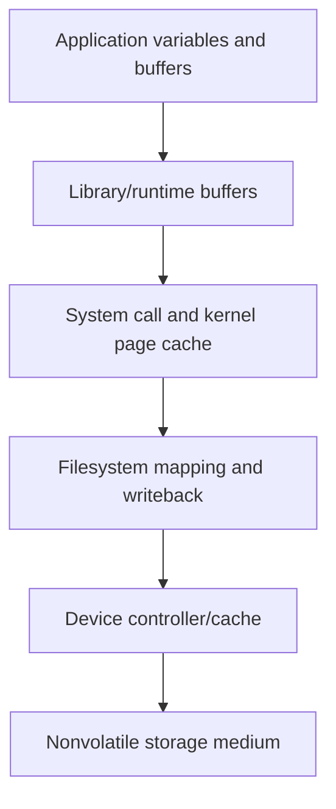
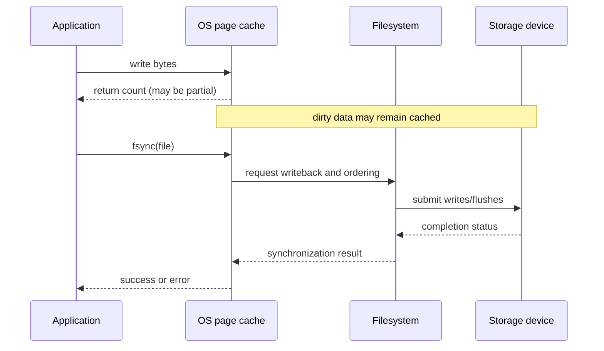

# V01-C05 — Files, Memory, and Persistent Storage

**Volume:** I — Data, Computing, and Database Foundations
**Part:** I — Data and Computing
**Status:** NEEDS REVIEW
**Prerequisites:** [V01-C04 — Bits, Bytes, Types, and Encodings](V01-C04-bits-bytes-types-encodings.md)
**Next:** [V01-C06 — Programs, Processes, and Client-Server Basics](V01-C06-programs-processes-client-server.md)
**Glossary:** [Canonical terms](../../../glossary.md)
**Concept index:** [Index](../../../INDEX.md)

## Learning objectives

After this chapter, you should be able to:

1. Distinguish a process's virtual address space, physical memory, file abstraction, page cache, and storage device.
2. Explain why file APIs can hide physical-device details without guaranteeing durability.
3. Trace a buffered write from application memory through an operating-system cache toward persistent media.
4. Explain partial reads/writes, delayed I/O errors, flushing, and directory-entry durability using Linux/POSIX examples.
5. Distinguish “the program accepted the write” from “the system has met a defined durability condition.”
6. Identify which assumptions must be specified before a database can claim persistence across failures.

| Objective | Assessment evidence |
|---|---|
| 1 | E1; layer ownership and distinctions in Sections 2–4 |
| 2 | E2–E3; file/API and synchronization scope in Sections 3 and 5 |
| 3 | E1–E2; write path and persistence timeline in Sections 2, 4–5 |
| 4 | E3–E4; Linux namespace, short-read/write, and error cases in Sections 3 and 5 |
| 5 | E2, E3, E5–E6; explicit contract reasoning in Sections 5 and 8 |
| 6 | E5–E6; failure-model and recovery assumptions in Section 8 |

## 1. Why files and memory matter to a database

A database is commonly expected to remember information after an application exits or a machine restarts. Yet programs normally work with values in memory, and memory is not all persistent. A program may change a buffer in its own address space; the operating system may copy those changes into a cache; a filesystem may schedule writes; a storage device may have its own volatile cache; and only later may information reach nonvolatile media. “I called write” and “the bytes will survive a power loss” are different claims.

Database engines are built on top of operating systems, filesystems, and devices. They must understand what those layers promise, what they defer, and what errors they can report. This chapter develops a conceptual model of files and storage boundaries. It uses Linux/POSIX examples where exact system-call behavior matters; other operating systems and filesystems may expose different APIs and guarantees.

## 2. A hierarchy of representations and storage

The path from program values to persistent data often looks like this:



The arrows are data movement or responsibility boundaries, not a guarantee that every write follows one identical path. Memory-mapped I/O, direct I/O, remote filesystems, virtualized devices, and different filesystem implementations change the details. The Linux kernel documentation describes its page cache as the primary interface through which normal filesystem reads and writes interact with file data; direct I/O can bypass it [R-019].

### 2.1 Volatile and nonvolatile state

**Volatile memory** generally requires power to retain its current contents. Main memory (RAM) is fast and directly usable by a running program but is normally lost on restart or power failure. **Nonvolatile storage** is designed to retain data without power, but the word “persistent” still depends on device, firmware, filesystem, and failure assumptions.

Storage technologies trade capacity, latency, throughput, endurance, cost, and access pattern. Registers and CPU caches are close to computation and small; RAM is larger; SSDs and disks provide much larger persistent capacity but typically have higher access latency. This hierarchy motivates caching, batching, and pages in database systems. The exact latency values vary by device and workload, so this chapter avoids universal numbers.

### 2.2 Virtual memory is an address-space abstraction

A process usually uses **virtual addresses** rather than direct physical RAM addresses. The operating system and memory-management hardware translate virtual addresses to physical locations, enforce isolation, and may page some memory to backing storage. This abstraction lets a program reason about its own address space without owning the machine's raw memory layout.

Virtual memory does not mean that all process memory is durable. A page backed by an ordinary file can be reloaded from that file, while anonymous process memory normally has no application-defined persistence contract. A database buffer pool is therefore an in-memory copy of database pages whose authoritative persistence rules must be specified separately.

## 3. The file abstraction

A **file** presents named, persistent-looking bytes through an operating-system interface. A filesystem organizes names into directories, associates metadata with file objects, and mediates access. Applications typically open a path and receive a handle or file descriptor used for reads, writes, seeking, synchronization, and closing.

The abstraction is valuable because the application can request operations on a byte sequence without programming each disk controller or flash translation layer. However, a file path is not the same as an open file handle, a directory entry is not the same as file contents, and a successful API call may mean only that data moved into an intermediate buffer.

### 3.1 Paths, names, and open handles

A path names a location in a filesystem namespace. Opening it resolves that name and creates or obtains a reference to an open file description. The handle has operation state such as an offset and access mode. Names can be renamed or removed while an open handle remains usable, depending on filesystem rules. Multiple names may also refer to one underlying file object through links.

For database recovery, a directory entry can be part of the durable state. Creating or renaming a database file changes both file data/metadata and the namespace entry that makes the file discoverable. Linux's `fsync(2)` documentation explicitly notes that synchronizing the file does not necessarily synchronize the directory entry containing it; an application needing that guarantee must synchronize the directory as well [R-018]. This is an OS-specific detail with broad design consequences: durable file creation may require more than flushing file contents.

### 3.2 Reads and writes are byte operations

At a low level, a file is often treated as a sequence of bytes. Higher-level formats layer records, fields, pages, checksums, and indexes over that sequence. A byte-oriented API does not know that a group of bytes is a valid database record unless the application defines and validates that structure.

System calls can complete partially. On Linux, `read(2)` may return fewer bytes than requested without indicating end-of-file, and `write(2)` may successfully transfer fewer bytes than requested; callers must use the returned count and continue or handle an error [R-017, R-034]. Rust's `Read`/`Write` traits have related byte-count behavior; `write_all` loops until completion or error, while `read_exact` either fills the target or returns an error [R-020]. Errors can also be delayed until a later write, synchronization call, or close. A robust file writer therefore tracks offsets, loops until all intended bytes are handled, and checks synchronization/close errors according to its contract.

A partial write has a serious implication for a database format: the file may contain a prefix of a record or page. The format must specify how incomplete structures are detected and whether recovery should reject, repair, or replace them. Later chapters develop checksums, page atomicity assumptions, and write-ahead logging.

## 4. The page cache and buffered I/O

To avoid device access on every operation, operating systems cache file data in memory. Under normal Linux file I/O, reads may be served from the page cache and writes commonly modify cached pages that are written back later [R-019]. This improves performance by coalescing and reordering I/O, but it also means an application and the storage device can temporarily disagree about what has reached persistent media.

Database systems add their own caches, such as a buffer pool. Two layers may therefore hold related copies: an engine-managed page frame and kernel-managed file cache pages. Some systems use direct I/O for selected paths; many rely on buffered I/O. Each choice affects alignment, caching, memory pressure, synchronization, and failure behavior. No design should assume that “bypassing cache” automatically makes writes durable or atomic.

## 5. What does “written” mean?

Consider these increasingly strong statements:

1. The application copied bytes into its own buffer.
2. A library accepted the bytes into a runtime buffer.
3. A write system call returned a positive byte count.
4. The kernel page cache contains modified file data.
5. The filesystem submitted writes to a storage device.
6. The device reported completion after its own required flush behavior.
7. The data and required metadata survive the failure model the application cares about.

The exact mapping among these statements depends on API and system behavior. On Linux, a successful `write()` does not guarantee that data has been committed to disk; errors may be delayed and `fsync()` requests synchronization under the documented Linux model [R-017, R-018]. A database durability claim must name its failure model: process crash, operating-system crash, sudden power loss, device failure, or loss of a remote replica are different cases.

### 5.1 Synchronization calls and their scope

On Linux, `fsync(fd)` requests synchronization of modified in-core file data and associated metadata for the file descriptor. `fdatasync(fd)` may omit metadata not required for later data retrieval. The filesystem/device stack and hardware still matter; software must handle returned errors [R-018]. A directory sync may be needed to persist a namespace change such as file creation or rename.

These calls are not a universal recipe for transactional durability. They synchronize a file state under an OS contract; they do not make multi-page updates atomic, coordinate concurrent database transactions, or define recovery after an interrupted logical operation. Those are database-level mechanisms covered in Volumes VIII and IX.

### 5.2 A persistence timeline



The diagram is an explanatory Linux-style model, not a promise that every device protocol or filesystem has these exact internal steps. The application observes an API result, not the physical state of every storage cell. Durable systems build contracts around documented layers and test behavior under stated failure scenarios.

## 6. Rust file I/O as an engineering interface

Rust's `std::fs::File` exposes file operations and synchronization methods through safe APIs [R-020]. The error type encourages callers to handle I/O failure rather than pretending file access always succeeds. Rust's type safety does not change the operating-system persistence model: `write_all` can ensure the supplied buffer is fully written according to the API's retry behavior, but it does not itself promise that the bytes reached durable media. A caller must use synchronization and handle errors where the application's durability requirements demand it [R-020].

An illustrative pattern is:

```rust
use std::fs::File;
use std::io::{self, Write};

fn write_record(file: &mut File, bytes: &[u8]) -> io::Result<()> {
    file.write_all(bytes)?; // handles partial-write progression
    file.sync_all()?;       // request data and metadata synchronization
    Ok(())
}
```

This function is intentionally not presented as a complete database commit protocol. It has no framing, checksum, log ordering, transaction boundary, page atomicity, directory sync for creation/rename, group commit, or recovery logic. `sync_all` maps to platform-specific synchronization behavior documented by Rust and the operating system; its errors must be propagated. Real database systems may batch synchronization for performance while preserving a defined ordering protocol.

## 7. Why databases add storage structures above files

A file gives a byte stream or random-access byte range. A DBMS needs higher-level organization:

- **Records** associate bytes with fields and types.
- **Pages** group records into I/O and management units.
- **Indexes** map search keys to records or pages.
- **Buffer pools** keep frequently used pages in memory.
- **Logs** record changes in an order that supports recovery.
- **Catalogs** describe schemas, indexes, and other metadata.

These structures let the engine answer queries efficiently and enforce invariants, but they add responsibilities. A page update can span multiple device writes; an index can disagree with table data after a partial operation; a log must be synchronized before dependent data writes under write-ahead rules. A file API alone does not solve these problems. Later volumes progressively build the abstractions and recovery guarantees.

## 8. Failure scenarios to reason about

For a program that writes a new record, consider what happens if failure occurs:

- before the write call;
- after a partial write;
- after the write returns but before synchronization;
- during synchronization;
- after synchronization reports success but before the application receives the result;
- after file contents are synchronized but before the directory entry is durable;
- after one of several related files is synchronized but before the others.

The correct post-restart result depends on the promised contract. A record can be missing, complete, partially present, or present while related metadata is absent. A database must design its format and recovery protocol so that every possible interruption leads to a state that can be detected and handled.

### Failure model table

| Failure | Likely state to consider | What an application needs |
|---|---|---|
| Process exits normally | OS remains running; dirty pages may still be cached | Close/flush policy appropriate to the application |
| Process crashes | Kernel may continue and eventually write cache | Format must tolerate abrupt application interruption |
| OS crash/reboot | Volatile kernel state is lost | Explicit synchronization and recovery assumptions |
| Power loss | Device caches and in-flight I/O may be lost or reordered | Device/filesystem guarantees, barriers/flushes, recovery tests |
| Device/media failure | Data may be permanently unavailable/corrupt | Replication, backups, checksums, repair procedures |

This table is intentionally qualitative; exact guarantees differ by platform, filesystem, device, and configuration.

## 9. Practical experiment: observe buffered writes

**Objectives:** observe the API sequence and separate process-level evidence from claims about durable media. **Prerequisites:** Sections 3–6; Rust file I/O. **Environment:** Rust Edition 2024; record `rustc --version`, OS/kernel, filesystem and mount/device if known, and whether `strace` is available. **Input:** the synthetic nine-byte payload `SGDB-C05\n` in a newly created file in the system temporary directory. Do not use production data or simulate power loss on valuable data.

```rust
use std::fs::{self, OpenOptions};
use std::io::{self, Write};

fn main() -> io::Result<()> {
    let path = std::env::temp_dir().join(format!(
        "sgdatabase-c05-{}.tmp",
        std::process::id()
    ));
    let mut file = OpenOptions::new().write(true).create_new(true).open(&path)?;
    file.write_all(b"SGDB-C05\n")?;
    file.sync_all()?;
    drop(file);

    let observed = fs::read(&path)?;
    assert_eq!(observed, b"SGDB-C05\n");
    println!("readback={observed:?}");
    fs::remove_file(path)?;
    Ok(())
}
```

1. Compile and run the program; record the command, compiler version, and exact readback output.
2. Inspect the calls in source. If `strace` is installed, optionally run `strace -e trace=openat,write,fsync,close,read,unlink <program>` and compare observed calls with the source. Do not treat a system-call trace as evidence that physical media retained the data.
3. As a control, build a second temporary copy with `sync_all()` omitted. Record the changed call sequence. Both runs are expected to read back the payload while the OS remains running; that observation does not establish power-loss survival.
4. State whether this experiment syncs the containing directory. The sample does not request directory synchronization; creation/unlink namespace durability is therefore outside its contract.
5. Identify which errors are propagated and which failure models are not exercised. Do not kill the machine or pull power to manufacture a test.

**Expected behavior:** successful run prints `readback=[83, 71, 68, 66, 45, 67, 48, 53, 10]`; the synchronized run calls the Rust file synchronization API, while the control does not. **Deliverable:** source, exact command/output, environment record, optional trace, a layer diagram or table, and a paragraph delimiting the experiment's evidence. **Verification:** assertions pass; file is removed on successful exit. A leftover temp file after failure should be inspected manually and removed by the learner. **Assessment:** E6 rubric; this experiment makes no benchmark or crash-durability claim.

### Exercises

Worked responses and grading guidance are in the [separate solution guide](solutions/V01-C05-solutions.md). State platform and failure assumptions where relevant.

| ID | Level | Objectives | Prerequisites | Deliverable and assessment |
|---|---|---|---|---|
| C05-E1 — Trace a file write | 1–3 | 1, 3 | Memory/file concepts | Draw or tabulate a `Vec<u8>` write path; name ownership of each buffer and distinguish data movement from guarantees. 10 points: layers 5, ownership 3, limitations 2. |
| C05-E2 — API guarantees | 2–3 | 2, 3, 5 | Rust I/O basics | Compare `write`, `write_all`, `flush`, `sync_data`, and `sync_all`; state what each API means and does not mean. 15 points: correct distinctions 8, error behavior 4, persistence limit 3. |
| C05-E3 — Durable name creation | 3–4 | 2, 4, 5 | Linux paths/files | For create `db.new`, write, file sync, rename to `db`, explain remaining namespace persistence steps under Linux. 15 points: file vs directory 6, sequence/required sync reasoning 6, platform scope 3. |
| C05-E4 — Short I/O and interrupted format | 3–4 | 4 | Byte offsets; record/page framing | Given 400 of 600 bytes written, describe continuation; also explain short-read handling and two crash-detection/recovery protections. 20 points: write continuation 5, read behavior 4, two protections 7, errors/edge cases 4. |
| C05-E5 — Failure models | 4 | 5–6 | Sections 5 and 8 | Compare process crash, OS crash, and power loss; specify which observation cannot support which claim. 15 points: three models 6, evidence boundary 5, assumptions 4. |
| C05-E6 — Append-only durability contract lab | 4–6 | 2–6 | File I/O, failure models, record framing | Complete the Section 9 protocol and write a contract for a toy append-only file: failure model, synchronization point, recovery result for interrupted append, and test plan. 25 points: reproducible experiment 5, contract precision 7, recovery behavior 5, tests/failure cases 5, evidence limitations 3. |

**Permitted tools:** calculator and text editor for E1–E5; Rust toolchain and optional `strace` for E6. No power-failure test is permitted or needed. Alternatives are accepted if platform scope, observable evidence, and limitations are explicit.

## 10. Common misconceptions

### “A successful write means data is on disk.”

On Linux, the documented write call may leave data in cache and can defer errors. Synchronization is a distinct request, and the precise guarantee depends on the stack.

### “Closing a file always makes it durable.”

Close releases a handle and can report errors, but it is not a universal substitute for the specified synchronization operation.

### “RAM and a file are just two names for storage.”

They have different volatility, access, addressing, and persistence behavior. A database cache is a working copy, not automatically the durable authority.

### “The OS makes every file update atomic.”

The file abstraction does not promise that a logical record or multi-file update is atomic. The format and database recovery protocol must handle torn/partial state.

### “An fsync call makes a transaction correct.”

Synchronization can support durability but does not by itself provide atomicity, isolation, integrity, or recovery logic.

## 11. Summary

Programs operate through memory and file abstractions layered over operating systems, filesystems, caches, controllers, and storage devices. These layers improve convenience and performance but separate an accepted write from durable state. Virtual memory is an address abstraction, a page cache is a performance mechanism, and a file API is not a database transaction protocol.

Linux/POSIX examples show that writes may be partial, errors can be deferred, and file synchronization does not necessarily make the containing directory entry durable. Rust APIs can retry byte writes and surface errors, but they inherit platform persistence semantics. A database must define its failure model, ordering rules, file/page/log format, and recovery behavior rather than treating `write` or `fsync` as a complete correctness solution.

## Further reading

- Linux man-pages `read(2)`, `write(2)`, and `fsync(2)` for documented call behavior and limits [R-017, R-018, R-034].
- Linux kernel documentation on the page cache and virtual memory, for a concrete OS implementation [R-019].
- Rust standard library documentation for `File`, `Read`, `Write`, `write_all`, and synchronization methods [R-020].
- V01-C06 for process/client-server foundations; Volume V for pages and buffer pools; Volume IX for WAL and recovery.

## References

1. **R-034 — Official OS documentation.** Linux man-pages project. [`read(2)`](https://man7.org/linux/man-pages/man2/read.2.html). Documents Linux/POSIX short reads, EOF, and errors; page text accessed 2026-11-14.
2. **R-017 — Official OS documentation.** Linux man-pages project. [`write(2)`](https://man7.org/linux/man-pages/man2/write.2.html). Documents partial writes and delayed errors; Linux/POSIX behavior, rechecked 2026-11-14.
3. **R-018 — Official OS documentation.** Linux man-pages project. [`fsync(2)`](https://man7.org/linux/man-pages/man2/fsync.2.html). Documents data/metadata synchronization and directory-entry caveat; Linux behavior, rechecked 2026-11-14.
4. **R-019 — Official OS documentation.** Linux kernel documentation. [Page Cache](https://docs.kernel.org/mm/page_cache.html). Documents the page cache's role in Linux filesystem I/O; rechecked 2026-11-14.
5. **R-020 — Official language/library documentation.** The Rust Project. [`std::fs::File`](https://doc.rust-lang.org/std/fs/struct.File.html), [`std::io::Read`](https://doc.rust-lang.org/std/io/trait.Read.html), and [`std::io::Write`](https://doc.rust-lang.org/std/io/trait.Write.html). Relevant pages accessed 2026-11-14; library docs identify Rust 1.100.0.

## Earlier draft review

The 2026-11-11 inspection checked selected Linux API scope and Rust I/O descriptions. It was a draft review only, before the measurable chapter acceptance policy; it did not include exercise rubrics, separate solutions, or a reproducible lab protocol and did not establish COMPLETED status.

## Chapter acceptance record

- **Status:** NEEDS REVIEW.
- **Review date:** 2026-11-14 (Asia/Bangkok).
- **Reviewer:** Internal technical/editorial review; no independent external peer review is implied.
- **Objectives and assessment:** All six objectives map to six assessed exercises and the laboratory. Exercises include level, prerequisites, deliverable, expected evidence, and point rubric; worked solutions are in `solutions/V01-C05-solutions.md`.
- **Technical claims and research:** Linux behavior maps to R-017 (write), R-018 (fsync), R-019 (page cache), and R-034 (read); Rust API claims map to R-020. Sources were opened/rechecked 2026-11-14. Linux/POSIX-specific claims are labeled and not generalized.
- **Correctness and failure cases:** Partial read/write, deferred errors, sync scope, namespace durability, process/OS/power/device failure distinctions, and the distinction between detection and repair are explained. The toy append contract is illustrative, not production guidance.
- **Code and environment:** Both Rust examples compiled under `rustc 1.97.1 (8bab26f4f 2026-07-14) --edition=2024`; the lab program executed and read back the expected nine bytes. This validates the sample API calls, not durability across process/OS/power failure. No `strace` trace or crash test was performed.
- **Exercises and solutions:** Six exercises map all objectives with point rubrics; separate answer guidance and a model append contract are in `solutions/V01-C05-solutions.md`.
- **Navigation and references:** Prerequisite/next links, stable ID, solution link, glossary/index, source IDs, and catalog metadata checked.
- **Diagrams:** Two Mermaid diagrams are meaningful and described in the surrounding text, but parser validation remains OPEN: no `mmdc`, Mermaid executable, global Node package, cached Mermaid package, or Python Mermaid parser was available in the checkout/environment. Do not mark COMPLETED until both diagrams pass a Mermaid parser and the result is logged.
- **Editorial review:** API vs durability, file vs name, page cache vs buffer pool, and evidence vs inference distinctions were checked.
- **Validation:** See QR-012 for executed checks and limitations. `git diff --check` passes. No Cargo workspace exists, so Cargo commands do not apply.
- **Open acceptance item:** Validate the two Mermaid diagrams with an actual parser. All other reviewed requirements have evidence recorded; this one OPEN item prevents COMPLETED under `EDUCATIONAL_STANDARDS.md`.
