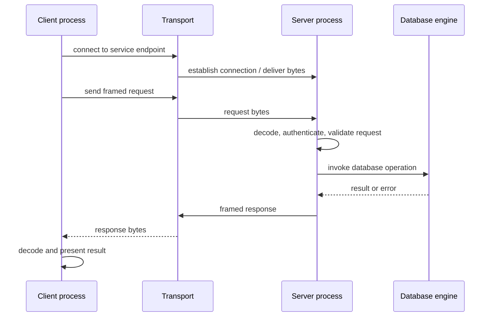

# V01-C06 — Programs, Processes, and Client–Server Basics

**Volume:** I — Data, Computing, and Database Foundations  
**Part:** I — Data and Computing  
**Status:** DRAFT  
**Prerequisites:** [V01-C05 — Files, Memory, and Persistent Storage](V01-C05-files-memory-persistent-storage.md)  
**Next:** V01-C07 — What Is a Database? (planned in Part II)  
**Glossary:** [Canonical terms](../../../glossary.md)  
**Concept index:** [Index](../../../INDEX.md)

## Learning objectives

After this chapter, you should be able to:

1. Distinguish a program, process, thread, and network service.
2. Explain why process isolation and shared files affect database architecture.
3. Describe a client-server request/response flow and distinguish transport from application protocol.
4. Explain that TCP presents a byte stream and does not preserve application message boundaries.
5. Identify failure, timeout, identity, resource, and security issues at a service boundary.
6. Relate embedded and client/server database deployment styles to process boundaries without treating either as universally superior.

## 1. A program is not the same thing as a running service

A **program** is an executable description of instructions and data. When an operating system starts a program, it creates a **process**: an executing instance with resources such as a virtual address space, open file handles, credentials, and one or more threads of execution. A **thread** is an execution path scheduled within a process; threads in the same process generally share its address space and many process resources.

A **service** is a program or set of programs that makes some capability available to other components, often over a local or network interface. A **client** initiates a request; a **server** listens for or receives requests and produces responses. These are roles in an interaction, not necessarily different kinds of machine. A single process can act as both client and server for different connections, and client and server processes may run on the same host.

This distinction matters for databases. An embedded engine can run inside the application's process and access a file directly through a library API. A client/server DBMS runs as a separate service process and accepts requests from clients. These arrangements shift the location of resource ownership, failure boundaries, authentication, concurrency coordination, and deployment work.

## 2. Process isolation and shared resources

Operating systems isolate processes so that one process normally cannot directly read or overwrite another process's private memory. They communicate through explicit mechanisms such as files, pipes, shared memory, message queues, and sockets. This boundary can contain memory faults and allow the server to outlive one client, but it also requires protocols and resource management.

Threads within one process communicate through shared memory, which can be efficient but requires synchronization when mutable state is shared. A database server may use one process, several processes, multiple threads, or a hybrid architecture. There is no single universal process model. PostgreSQL, for example, documents a server instance that starts a separate server process to handle a client connection; other engines use different models.

### 2.1 Process creation as one concrete OS model

On Linux, `fork()` creates a child process with a separate memory space initially containing the parent's memory values. The child inherits copies of open descriptors that may refer to the same underlying open file description, so file offsets and flags can be shared in specific cases. This example shows why “separate process” does not mean every resource is copied independently.

This is Linux/POSIX behavior, not a required architecture for database servers. Other operating systems and server designs use different process creation and connection handling. The portable conceptual point is to ask which state is private, which is shared, and which boundary governs failure and access.

## 3. Client-server request flow

A simple client-server interaction can be decomposed into stages:



The transport delivers bytes between endpoints. An **application protocol** defines how those bytes form requests and responses, which operations are allowed, how values are encoded, how errors are represented, and when connections are closed. The database query language is yet another layer: SQL text or a binary query representation may be embedded inside a protocol message.

Separating these layers helps localize problems. A TCP connection can work while the application protocol is malformed; a request can be syntactically valid while SQL semantics reject it; a query can succeed while the client loses the response before receiving it.

## 4. Connections and byte streams

TCP provides a reliable, ordered, full-duplex byte stream between connected endpoints, subject to connection failure and resource limits. “Reliable” describes delivery behavior while the connection can be maintained; it is not a promise that a server has committed a database transaction. TCP also does not preserve application record boundaries. If a client writes a 100-byte message, the server's reads may return fewer or more bytes per call than the client's write boundaries suggest.

An application protocol therefore needs **framing**. Common designs include:

- a fixed-size header containing the following payload length;
- a delimiter with escaping rules;
- a fixed-size message format;
- a higher-level framing protocol that carries a type and length.

With length-prefix framing, the receiver first reads the complete header, validates the declared length against a maximum, then reads exactly that many bytes. It must handle partial reads, EOF in the middle of a frame, malformed lengths, and resource exhaustion. A declared length is untrusted input; allocating it before checking limits can let a client request an enormous buffer.

### Worked example: writes do not define messages

Suppose a client sends frames `HELLO` and `QUERY`. The TCP stack may deliver their bytes as one read containing `HELLOQUERY`, several reads splitting `HEL` from `LOQUERY`, or any other segmentation preserving stream order. The server must recover frame boundaries from the application protocol, not assume one read corresponds to one client write.

## 5. The service lifecycle

A conventional TCP server lifecycle is:

1. Create a listening socket.
2. Bind it to a local address and port.
3. Listen for incoming connection attempts.
4. Accept a connection, obtaining a per-connection endpoint.
5. Read framed requests and write framed responses.
6. Handle disconnects, errors, timeouts, and shutdown.

A client resolves or selects a server address, establishes a connection, authenticates according to the application protocol, sends requests, receives responses, and eventually closes or reuses the connection. Linux `accept(2)` can block while waiting for a pending connection on a blocking listening socket; nonblocking designs integrate readiness notification and event loops.

The Rust standard library's `TcpListener` exposes listening and connection-accept operations. A small synchronous example is:

```rust
use std::io;
use std::net::TcpListener;

fn accept_one() -> io::Result<()> {
    let listener = TcpListener::bind("127.0.0.1:9000")?;
    let (_stream, peer) = listener.accept()?;
    println!("connected: {peer}");
    Ok(())
}
```

This example binds only to the local loopback interface and accepts one connection. It does not implement a database protocol, authentication, TLS, request framing, concurrency, graceful shutdown, or production error policy. It is useful only to show that a socket endpoint is an OS-managed resource with fallible operations.

## 6. Failure and ambiguity across a request boundary

Distributed interaction creates ambiguity. Consider a client sends “transfer 10 units” and then times out. Possible realities include:

1. The request never reached the server.
2. The server received but rejected it.
3. The server performed the operation but the response was lost.
4. The server is still processing it.

The client cannot infer which case occurred from a timeout alone. Retrying may duplicate an operation unless the protocol and database operation use idempotency keys, transaction identifiers, or another deduplication strategy. This problem appears before learning distributed transactions and is one reason request semantics and recovery behavior must be designed together.

Other important boundary conditions include:

- connection reset or half-close while data remains buffered;
- slow clients that occupy file descriptors, memory, or worker slots;
- requests that exceed size or time limits;
- authentication failure and authorization checks;
- protocol version mismatch;
- server restart while clients have in-flight requests;
- resource exhaustion through too many connections or expensive queries.

Networking is not merely a way to “send SQL.” It creates a failure and security boundary that the server must manage deliberately.

## 7. Embedded engine versus client/server DBMS

An **embedded database engine** is linked into or otherwise run within an application context; the application often calls library functions and the engine accesses database files. A **client/server DBMS** runs as a service process and receives requests through an IPC or network protocol.

| Concern | Embedded style | Client/server style |
|---|---|---|
| Process boundary | Often shares the application's process | Engine service has a distinct process boundary |
| Request path | Function/library calls | Protocol messages over local IPC or network |
| Deployment | Engine library and data file travel with the app | Server installation/configuration and client connectivity |
| Coordination | Often relies on filesystem locking and library coordination | Server coordinates connections and shared engine state |
| Failure isolation | Engine fault may affect the application process | Server/client can fail separately, though shared host failures remain |
| Remote access | Not inherently provided by the engine boundary | A common built-in use case |

These are tendencies, not guarantees. SQLite is an embedded library and explicitly documents its suitable use cases and single-writer behavior; some embedded systems support networked deployments through additional services. Some client/server systems are deployed locally. Choosing a style depends on workload, write concurrency, operational skill, security needs, and deployment constraints.

## 8. Security principles at the service boundary

A network-accessible DBMS exposes an attack surface. A server should authenticate peers, authorize each operation, validate message framing and sizes, avoid unsafe deserialization, use protected transport when needed, and avoid leaking secrets through errors or logs. Localhost binding is not a complete security strategy when untrusted local processes exist. Network encryption does not replace authorization, and authorization does not prevent resource exhaustion.

The least-privilege principle applies to both server process credentials and database users. A server process should have only the filesystem, network, and operating-system rights necessary for its job. Database accounts should receive only the operations required by their applications. Security will be developed systematically in Volume XI; here the key idea is that a process/protocol boundary must be treated as untrusted input.

## 9. Practical experiment: outline a tiny protocol

Design a request/response protocol for one operation, such as “fetch record by key.” Do not implement a database. Specify:

1. Message framing and maximum request/response sizes.
2. How operation type and fields are encoded.
3. How the server reports malformed input, missing records, and internal failure.
4. How the client distinguishes a timeout from a definitive rejection.
5. What prevents duplicate effects when retrying a write operation.
6. Which data is authenticated and how access is authorized.

Then write a byte-level example request using the encoding concepts from V01-C04. Ask another learner to decode it without verbal help. The exercise is about explicit contracts, not a production protocol design.

### Exercises

1. Explain the difference between program, process, thread, and service using a DBMS example.
2. Draw an embedded database interaction and a client/server interaction. Mark which process owns the database engine and file handle.
3. A client writes a 40-byte request over TCP. Give three legal patterns of server-side read sizes that still deliver the same byte stream.
4. Design a length-prefixed request header. State how the server rejects an invalid or excessive length before allocation.
5. A client times out after a write request. Explain why blindly retrying may be unsafe and propose protocol metadata to support deduplication.
6. List four resources a slow or malicious client can consume and a limit or policy for each.
7. Explain why TCP's reliability does not establish that a database transaction committed.

## 10. Common misconceptions

### “One TCP write becomes one server read.”

TCP exposes an ordered byte stream, not application message boundaries. The protocol must define framing.

### “A timeout means the operation failed.”

A timeout means the client did not receive a timely result. The server may not have received the request, may still be working, or may have committed an effect whose response was lost.

### “Processes never share resources.”

Processes have isolated address spaces, but they can share files, inherited open descriptions, shared memory, sockets, and other OS-managed resources.

### “Embedded means single-user and client/server means distributed.”

These are deployment/interface patterns. Actual concurrency, remote access, and failure behavior depend on the product and configuration.

## 11. Summary

A program becomes a process when the OS executes it; a process owns an address space and resources, while its threads may share process memory. A service exposes operations to clients through an interface. Client/server architecture introduces explicit process, protocol, security, and failure boundaries; embedded engines place the engine closer to the application and often avoid a network protocol on each call.

TCP provides a reliable ordered byte stream but does not preserve application message boundaries or prove database commit. Protocols must frame and validate requests, apply resource limits, authenticate and authorize peers, and define how timeouts and retries behave. These foundations prepare us to ask what a database is, what responsibilities a DBMS takes on, and how different deployment styles meet different workloads.

## Further reading

- RFC 9293 for the current TCP protocol specification.
- Linux man-pages `fork(2)` and `accept(2)` for concrete process and socket APIs.
- Rust standard library `TcpListener` documentation.
- SQLite's appropriate-use guidance and PostgreSQL server process docs, referenced in V01-C01 and V01-C08.

## References

1. Linux man-pages project. [`fork(2)`](https://man7.org/linux/man-pages/man2/fork.2.html). Linux process creation behavior; accessed 2026-11-11.
2. Eddy, W. (Ed.). (2022). RFC 9293, *Transmission Control Protocol (TCP)*. [RFC Editor](https://www.rfc-editor.org/rfc/rfc9293). Current IETF TCP specification; accessed 2026-11-11.
3. Linux man-pages project. [`accept(2)`](https://man7.org/linux/man-pages/man2/accept.2.html). Linux connection-accept behavior; accessed 2026-11-11.
4. The Rust Project. [`std::net::TcpListener`](https://doc.rust-lang.org/std/net/struct.TcpListener.html). Official standard library API; accessed 2026-11-11.

## Chapter review record

- Client/server layering and TCP stream semantics are separated from database request semantics.
- Process and socket details are labeled as Linux-specific where appropriate; TCP claims cite RFC 9293.
- Rust code is a bounded demonstration, not a protocol or server implementation.
- Remaining review: registry, glossary/index links, local links, and source-record entries before completion.
